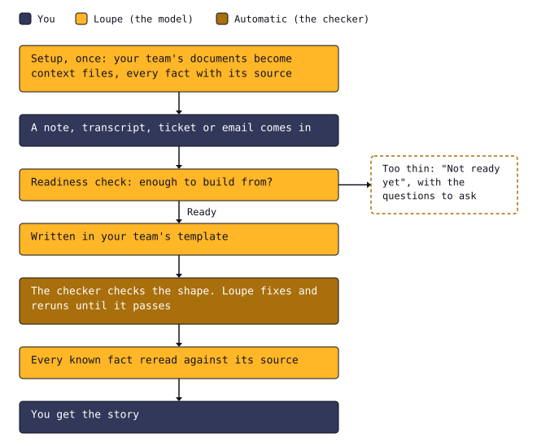

<p align="center">
  <picture>
    <source media="(prefers-color-scheme: dark)" srcset="brand/lockup-dark.svg">
    
  </picture>
</p>

<p align="center"><a href="https://github.com/mpwilso/loupe/actions/workflows/tests.yml"></a></p>

<p align="center"><b>Turns meeting notes into stories a developer can build. It won't hand you one it can't back up.</b></p>

A Claude skill for product managers, in Claude or Claude Code. Each fact in a story points at where it came from, and an input too thin to build from gets the questions to ask instead of a story.

Status: a portfolio project, built to show how I design, test and judge an AI tool. Tried on one invented team across ten trials, with reruns. Every trial is in [docs/trials](docs/trials/README.md), including the misses.

## What a story looks like

Every story opens with three lines: the call (written, or not ready yet), how confident Loupe is, and the question to ask before anything else.

> Call: Story written<br>
> Confidence: Medium, who, what, where and the cutoff are clear, but billing for a moved box is untested.<br>
> First question: Does skipping count as a payments change under the December freeze, since it affects charging?
>
> **Test scenarios**
>
> TEST SCENARIO: Skip the next box from my account<br>HAPPY PATH: Before the cutoff<br>WHEN my next box's cutoff has not passed<br>AND I skip it from my account<br>THEN it moves to the next regular delivery date. To confirm: whether and how the page shows the new date.<br>UNHAPPY PATH: After the cutoff<br>WHEN my next box's cutoff has passed<br>AND I open my account<br>THEN I can't skip it. To confirm: what the page shows instead.
>
> **Known**
>
> - Skips were the top Helpline reason in August: 610 of 4,100 tickets, about three minutes of agent time each. Customers who cancel to avoid a box are lost about half the time. (Dana, meeting 2026-09-22)
> - No box can change within 72 hours of its ship date. The cutoff is stored per box and already shown on the "change my box" page. (Theo and Sam, meeting 2026-09-22)
>
> **Unknown**
>
> - Whether the billing job leaves out a box whose date moved. Sam has not checked yet.

The full story, with its background, requirements, test scenarios, estimate and questions, is below.

<details>
<summary>The skip-a-box story, written from a meeting transcript</summary>

```markdown
Call: Story written
Confidence: Medium, who, what, where and the cutoff are clear, but billing for a moved box is untested.
First question: Does skipping count as a payments change under the December freeze, since it affects charging?

# Let subscribers skip their next box from their account

## The story
As a subscriber, I want to skip my next box from my account, so that I don't pay for refills I don't need yet or wait on support.

## Background
Skips were the top Helpline reason in August: 610 of 4,100 tickets, about three minutes of agent time each. (Dana, meeting 2026-09-22)
Customers who cancel to avoid a box are lost about half the time. (Dana, meeting 2026-09-22)

## Example
Customers going on holiday, or with plenty of refills left, want to skip the next box, and today they have to email support or open a chat. (Dana, meeting 2026-09-22)

## Requirements
1. A subscriber can skip their next box from their account until the box's cutoff, 72 hours before the ship date today.
2. A skipped box moves to the next regular delivery date. To confirm: whether and how the page shows the new date.
3. After the cutoff, the subscriber can't skip the box. To confirm: what the page shows instead.
4. A skipped box isn't charged on its original ship date.
5. Stockroom's history shows a note that the customer skipped the box. To confirm: the exact wording (Dana suggested "Skipped by customer") and whether it shows the date and time.

## Not included
- Skipping any box other than the next one. Priya decided on the next box only for now. (meeting 2026-09-22)

## Notes
- The cutoff is already stored per box and shown on the "change my box" page, so skipping can reuse it. (Theo and Sam, meeting 2026-09-22)

## Test scenarios
TEST SCENARIO: Skip the next box from my account
HAPPY PATH: Before the cutoff
WHEN my next box's cutoff has not passed
AND I skip it from my account
THEN it moves to the next regular delivery date. To confirm: whether and how the page shows the new date.
UNHAPPY PATH: After the cutoff
WHEN my next box's cutoff has passed
AND I open my account
THEN I can't skip it. To confirm: what the page shows instead.

TEST SCENARIO: Billing for a skipped box
HAPPY PATH: Skipped box
WHEN I skip my next box
AND its original ship date passes
THEN I am not charged for it
UNHAPPY PATH: Box not skipped
WHEN I don't skip my next box
AND its ship date comes
THEN I am charged on the ship date

TEST SCENARIO: Stockroom shows the customer's skip
HAPPY PATH: Skipped by the customer
WHEN a subscriber skips a box
AND an agent opens them in Stockroom
THEN the history shows a note that the customer skipped it. To confirm: the exact wording (Dana suggested "Skipped by customer") and whether it shows the date and time.
UNHAPPY PATH: Skip refused after the cutoff
WHEN the box's cutoff has passed, so the subscriber can't skip it
AND an agent opens them in Stockroom
THEN the box keeps its date and no skip note shows

## Known
- Skips were the top Helpline reason in August: 610 of 4,100 tickets, about three minutes of agent time each. Customers who cancel to avoid a box are lost about half the time. (Dana, meeting 2026-09-22)
- No box can change within 72 hours of its ship date. The cutoff is stored per box and already shown on the "change my box" page. (Theo and Sam, meeting 2026-09-22)
- Scope is the next box only. A skip moves it to the next regular delivery date, the same as agents do today. (Priya and Dana, meeting 2026-09-22)
- Subscribers are charged on the ship date. (Sam, meeting 2026-09-22)
- This must ship before the December freeze: no risky changes to checkout or payments from 1 December to 5 January. (Priya, meeting 2026-09-22; dates from the planning email, Priya Raman, 2026-09-18, via the Priorities context file)

## Unknown
- Whether the billing job leaves out a box whose date moved. Sam has not checked yet.
- What happens if the box's cutoff passes while the subscriber has the page open.
- Whether a subscriber can also skip the box after one they already skipped.
- Where skipping sits: the account home page, the "change my box" page, or both.
- Whether a subscriber can skip a box whose payment has already failed.

## Assumed
- The web app can write the "Skipped by customer" note, so Stockroom needs no code change.

## Confidence
Medium
Why: Who, what, where and the cutoff are clear, but billing for a moved box is untested.
How to raise it: Sam skips a box in staging and confirms the billing job does not charge it.

## Estimate
12 to 20 hours
Basis: Sam said "a couple of days if billing behaves" in the meeting on 2026-09-22, read here as two working days. It assumes billing needs no change, and it does not include undo. Stockroom 50% not included, since Stockroom is assumed unchanged.

## Questions before building
- Does skipping count as a payments change under the December freeze, since it affects charging?
- Can a subscriber undo a skip before the cutoff? Dana wants it, Sam says it adds work, and no one decided.
- If billing does charge a skipped box, is fixing that part of this story or a separate one?
- Which system decides the "next regular delivery date"? The web app and Stockroom sometimes disagree. (Priorities context file)
- Is any change to the box's cutoff, 72 hours today, planned while skipping is live?
More open questions than fit here. Consider a spike first.

Before release: Tell support that subscribers can skip online and how skips show in Stockroom.
```

</details>

## What's different

A story can look done and still hide what nobody knows: a rule no one checked, a screen no one described, a number with no source. The developer finds the gaps halfway through the build, and the team books a second meeting to fill them. Loupe puts those gaps on the page before anyone starts.

- **It refuses thin input.** Below the bar you get "Not ready yet" and the questions to ask, not a story.
- **Every known fact names its source.** A fact with no source is unknown, and the story says so.
- **Guesses are marked "To confirm".** They are never stated as fact.
- **Stories are written for developers and QA.** User and job stories have a background, numbered requirements and test scenarios, each scenario with a happy path and at least one unhappy path.
- **A checker enforces the shape.** Loupe keeps fixing the story until it passes.
- **It learns your team from your documents, your corrections and your answers.** Every learned fact names its source, and nothing is saved without your yes.
- **In Claude Code, it keeps to its folder.** It reads your team's context from a `loupe/` folder in your repository and writes nowhere else.
- **In Claude Code, it can read your tracker and create tickets.** It searches the team's tracker before writing, cites any ticket it uses with when it was read, and flags likely duplicates. It creates a ticket from a finished story after showing you exactly what it will create and asking, and it never changes an existing ticket.

## How it works

<picture><source media="(prefers-color-scheme: dark)" srcset="docs/img/how-it-works-dark.svg"></picture>

Loupe learns your team once, from your own documents. Each input then gets a readiness check, a story in your team's template, and a checker that sends it back until it fits. Before you see it, Loupe rereads every known fact against its source.

## Try it

- **Claude:** download `loupe-skill.zip` from the [latest release](https://github.com/mpwilso/loupe/releases/latest) and upload it in Customize, then Skills. You need a Claude account with Skills and code execution turned on. The project setup, step by step, is in [docs/claude-project.md](docs/claude-project.md).
- **Claude Code plugin:** run `/plugin marketplace add mpwilso/loupe`, then `/plugin install loupe@loupe`. Untested in trials.
- **Claude Code installer:** clone this repository and run `node scripts/install-claude-code.ts`. Then keep your team's context in a `loupe/` folder in your repository: [docs/claude-code.md](docs/claude-code.md). The terminal is tested; the VS Code extension isn't yet.

Then type "set up the team" and point Loupe at your team's documents. After that, paste notes, a transcript, a ticket or an email. To search your tracker before writing, and to create tickets from finished stories, see [docs/live-context.md](docs/live-context.md).

## What the trials found

- **A fair baseline.** Trial 1's plain-Claude comparison was given Loupe's own context files, which taught it Loupe's format. In trial 2 it got the team's raw files and nothing else. In blind review it gave a usable estimate on 1 of 4 stories, against Loupe's 4 of 4, and Loupe kept the same format every time. ([trial 1](docs/trials/2026-09-30-trial-1.md), [trial 2](docs/trials/2026-09-30-trial-2.md))
- **Guesses marked.** In trial 3's blind review, trial 2's stories stated 9 guessed behaviors as fact. Before trial 3, the "To confirm" rule was extended from behavior to screen details, and trial 3 had 0. ([trial 2](docs/trials/2026-09-30-trial-2.md), [trial 3](docs/trials/2026-09-30-trial-3.md))
- **Tickets after a yes.** Every ticket created in trial 9 matched its story byte for byte, compared by script, and nothing was created without a yes. ([trial 9](docs/trials/2026-10-01-trial-9.md))

Each trial was run by hand and recorded, on one small invented team with a handful of inputs each. What every trial found, and what changed after it, is in [docs/trials](docs/trials/README.md). The scripts that ran trial 9 and compared its tickets with their stories are in [scripts/trials](scripts/trials/).

## Limits

- Tested on one invented company, at about one to three minutes per story, by the people who built Loupe. [docs/trials](docs/trials/README.md) says who scored each trial, and which were blind.
- Reading a tracker and creating tickets were tested on an invented mock tracker, never a real one, with Claude Code's own permission prompt stood in for in trial 9.
- The customer-data detector catches emails and secrets, but not names, phone numbers or street addresses.

The full list is in [docs/limits.md](docs/limits.md).

## How it was built

I designed and directed Loupe: I set the quality bar, designed ten trials, with reruns, and fixed what each exposed. Trials 1 to 6b were run in claude.ai, and trials 7 to 10 in Claude Code. Two of the trials were scored in blind review, one of them against plain Claude. Claude Code wrote most of the code. The trials are in [docs/trials](docs/trials/).

The model writes the story, and code checks it, so a story's shape doesn't depend on the model behaving: the checker rejects any story that doesn't fit, and a draft it couldn't check says so. The story shape is data in `spec/*.json`. The checker in `src/` enforces it, and the skill loops until the story passes. Zero runtime dependencies. TypeScript, run directly by Node 22.18 or newer. CI tests on Node 22.18.0 and 24.21.0.

Run the tests with `scripts/test.sh`. Check a story file yourself with:

```
node src/run.js check examples/pellwick/expected/skip-a-box.md
```

It prints `Checked with Node` and the version when the story passes, or one line per problem when it doesn't. Use `check-context` in place of `check` for context files. What each folder holds is in [docs/layout.md](docs/layout.md).

## What's next

1. Checks against your lower environments that read and never change anything, so a story can cite how the system behaves today.
2. Estimates calibrated on your team's history.

## The other tools

This is one of six tools. Three run in order: Loupe writes the story, [Parallax](https://github.com/mpwilso/parallax) builds it in a sandbox and keeps the record, and [ISR](https://github.com/mpwilso/isr) tells the person accepting it what is left to check. Three stand alone: [Polarizer](https://github.com/mpwilso/polarizer) holds an agent's risky tool calls until a person approves them, [Mordecai](https://github.com/mpwilso/mordecai) judges whether a Claude skill helps, and [Max Q](https://github.com/mpwilso/Project-Max-Q) ranks job postings against a profile. Each runs on its own. The three were run in order once, on one change: [ISR's run log](https://github.com/mpwilso/isr/blob/master/docs/run-log.md).

## License

[MIT](LICENSE).
